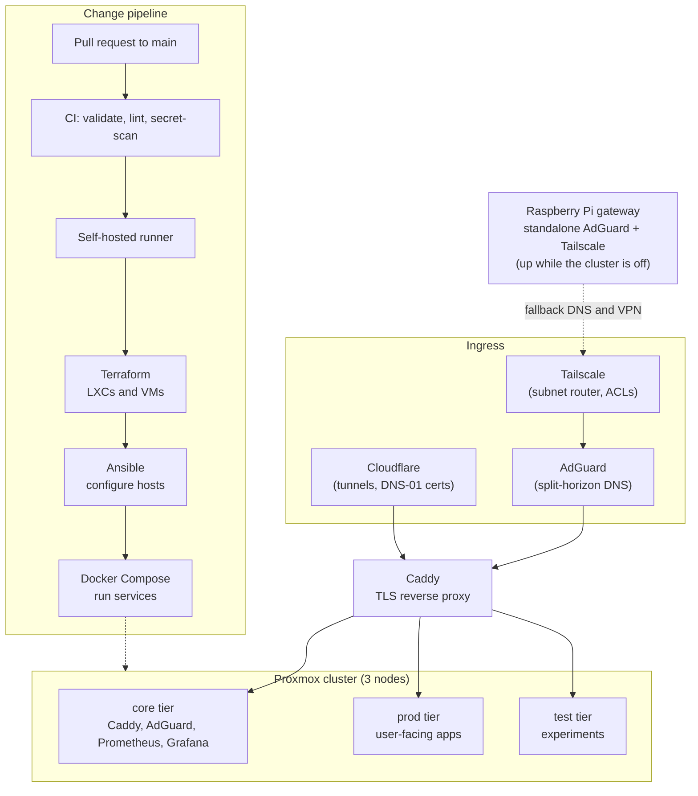

# Hyades

**Documentation:** [Hyades docs](https://hyades.iancoutinho.net)

Infrastructure-as-code for Hyades, a self-hosted homelab: a 3-node Proxmox cluster provisioned
**Terraform → Ansible → Docker Compose**, fronted by Caddy (TLS reverse proxy) and AdGuard (DNS).
Mostly Docker workloads inside LXCs, with a couple of QEMU VMs (macOS, Windows) for things that
don't fit. Everything, including the docs and the Tailscale ACLs, ships through Git and CI.

## Why Hyades?

The Hyades is the nearest open star cluster to Earth, about 150 light-years away in the
constellation Taurus. Its stars were born together from the same cloud and are held together by
gravity. This project is a small cluster in the same spirit: a few nodes bound by shared config
and code, all coming from one repo.

## Architecture

## Networking

Remote access and name resolution are first-class parts of the design.

- **Tailscale** is the remote-access path. A subnet router in the core tier advertises the LAN to
  the tailnet and doubles as an exit node, so a remote client reaches hosts the same way it would
  from home. The Raspberry Pi gateway runs a second Tailscale node so VPN access survives the
  cluster being powered off.
- **Split-horizon DNS** lives in AdGuard. One wildcard resolves service names to Caddy (TLS), and a
  second resolves to the host directly for SSH and raw ports. A standalone AdGuard on the Pi
  serves as the secondary resolver, because DNS sits on the critical path for the whole network.
  See [ADR 0004](docusaurus/docs/decisions/0004-split-dns-with-pi-secondary.md).
- **Tailscale ACLs as code.** The policy ([`policy.hujson`](policy.hujson)) is validated on pull
  requests and applied on merge by a CI workflow (which only runs in the maintainer's
  environment), and scopes subnet-route access separately from exit-node access. See
  [ADR 0007](docusaurus/docs/decisions/0007-tailscale-acl-route-scoping.md).
- **Tiers** (core, prod, test) each get their own subnet. Today the separation is by IP range
  only, not enforced by a firewall. See
  [ADR 0003](docusaurus/docs/decisions/0003-tier-per-node-placement.md).
- **TLS** is a wildcard certificate issued through Cloudflare DNS-01 and terminated at Caddy
  ([ADR 0002](docusaurus/docs/decisions/0002-caddy-over-nginx-proxy-manager.md)).

The full topology, generated from Terraform and the Caddyfile, is in
[`network.md`](docusaurus/docs/network.md).

## Stack

- **Provisioning**: Terraform creates the LXCs/VMs; Ansible configures them; Docker Compose runs
  the services.
- **Edge**: Caddy for automatic-HTTPS reverse proxy, AdGuard for DNS, Tailscale for remote access.
- **Services**: Authentik (SSO), Immich, Nextcloud, Grafana + Prometheus, Uptime Kuma, ntfy,
  SearXNG, n8n, and more, grouped into `core` / `prod` / `test` environments.
- **Docs**: a Docusaurus site at [`hyades.iancoutinho.net`](https://hyades.iancoutinho.net).

See [`AGENT.md`](AGENT.md) for the working source of truth on layout, workflow, and gotchas.

## Docs

Full docs live in [`docusaurus/docs/`](docusaurus/docs/).

| Doc                                                                                                                     | What                                                                     |
| ----------------------------------------------------------------------------------------------------------------------- | ------------------------------------------------------------------------ |
| [architecture](docusaurus/docs/architecture.md)                                                                         | Repo layout and how a change ships end to end                            |
| [network](docusaurus/docs/network.md)                                                                                   | Subnets, DNS, reverse proxy (generated from Terraform and the Caddyfile) |
| [hardware](docusaurus/docs/hardware.md) / [proxmox](docusaurus/docs/proxmox.md)                                         | Node specs, cluster, storage pools                                       |
| [ci](docusaurus/docs/ci.md) / [dev-workflow](docusaurus/docs/dev-workflow.md) / [git-flow](docusaurus/docs/git-flow.md) | CI pipeline, dev workflow, branch and PR flow                            |
| [runbooks/](docusaurus/docs/runbooks/)                                                                                  | Operational procedures (new service, backup and restore, node failure)   |
| [stack/](docusaurus/docs/stack/)                                                                                        | One page per service                                                     |
| [decisions/](docusaurus/docs/decisions/)                                                                                | ADRs: the trade-offs behind each major design choice                     |

## Infrastructure

- **LXCs**: Terraform-managed under [`terraform/envs/{core,prod,test}/`](terraform/envs/); compose
  stacks under [`services/{core,prod,test}/<service>/`](services/).
- **QEMU VMs**: ad-hoc (no module). See [AGENT.md § Current QEMU VM inventory](AGENT.md).
- **Gateways**: standalone AdGuard + Tailscale on a Raspberry Pi, under
  [`services/gateways/`](services/gateways/).

## Secrets

Secrets (`.env` files, `secrets/`, Ansible vault) are gitignored. Each service has an
`.env.example` listing the keys it needs with safe placeholders. See
[`SECURITY.md`](SECURITY.md) for the full policy and how to report a vulnerability.

## Contributing

Issues and discussion are welcome, and pull requests will be considered. This repo deploys real
infrastructure from `main`, so all changes go through a branch → PR → CI flow; see
[`CONTRIBUTING.md`](CONTRIBUTING.md). Note that this is one person's homelab, so some choices are
specific to that environment and may not be merged.

## License

[MIT](LICENSE)
